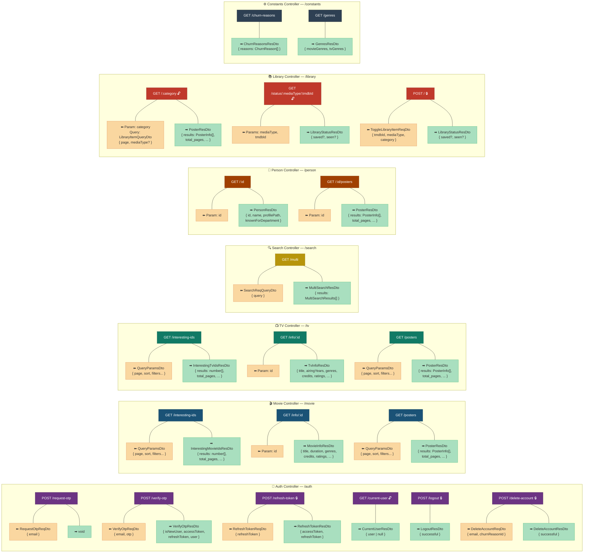

# 🐱 Meowie — Architecture Diagrams

---

## 1. Backend API Endpoints

> [!NOTE]
> 🔒 = Requires Access Token &nbsp;|&nbsp; 🔓 = Optional Auth (works for both guests and logged-in users)

---

## 2. React Native Component Architecture

```mermaid
graph TB
  classDef screen fill:#1B2631,stroke:#566573,color:#F7DC6F
  classDef feature fill:#1A5276,stroke:#2980B9,color:#fff
  classDef common fill:#6C3483,stroke:#8E44AD,color:#fff
  classDef ui fill:#117A65,stroke:#1ABC9C,color:#fff
  classDef data fill:#A04000,stroke:#E67E22,color:#fff
  classDef layout fill:#2E4053,stroke:#5D6D7E,color:#fff

  subgraph APP ["📱 App — Expo Router"]
    direction TB
    ROOT["_layout.tsx\n(Root Layout)"]:::screen

    subgraph TABS ["Tab Navigator"]
      direction LR
      TAB_HOME["🏠 Home Tab"]:::screen
      TAB_EXPLORE["🔍 Explore Tab"]:::screen
      TAB_PROFILE["👤 Profile Tab"]:::screen
    end

    subgraph STACK ["Stack Screens"]
      direction LR
      AUTH_REQ["Auth:\nRequest OTP"]:::screen
      AUTH_VER["Auth:\nVerify OTP"]:::screen
      DISCOVER_MOVIE["Discover:\nMovie Details"]:::screen
      DISCOVER_TV["Discover:\nTV Details"]:::screen
      DISCOVER_POSTERS["Discover:\nPosters"]:::screen
      DISCOVER_LIST["Discover:\nMedia List"]:::screen
      LIB_LIST["Library:\nMedia List"]:::screen
      PERSON_SCREEN["Person:\nDetails"]:::screen
      PERSON_LIST["Person:\nMedia List"]:::screen
      SEARCH_SCREEN["Search\nResults"]:::screen
      FILTER_SCREEN["Filters"]:::screen
      SETTINGS_SCREEN["Settings"]:::screen
      DELETE_ACCOUNT["Delete\nAccount"]:::screen
      ONBOARDING["Onboarding"]:::screen
    end
  end

  ROOT --> TABS
  ROOT --> STACK

  subgraph FEATURES ["🧩 Feature Modules"]
    direction TB

    subgraph HOME_FEAT ["Home"]
      HOME_SCR["HomeScreen"]:::feature
      MOVIE_CONTENT["MoviesContent"]:::feature
      TV_CONTENT["TvContent"]:::feature
      HOME_HEADER["Header"]:::feature
    end

    subgraph EXPLORE_FEAT ["Explore"]
      EXPLORE_SCR["ExploreScreen"]:::feature
      SEARCH_TRIGGER["SearchTrigger"]:::feature
    end

    subgraph PROFILE_FEAT ["Profile"]
      PROFILE_SCR["ProfileScreen"]:::feature
      LOGGED_IN["LoggedIn"]:::feature
      GUEST["Guest"]:::feature
      SAVED_LIST["SavedList"]:::feature
      SEEN_LIST["SeenList"]:::feature
    end

    subgraph MEDIA_FEAT ["Media"]
      MEDIA_LIST_SCR["MediaListScreen"]:::feature
      MOVIE_DETAILS["MovieDetails"]:::feature
      TV_DETAILS["TvDetails"]:::feature
      SAVE_BUTTON["SaveButton"]:::feature
    end

    subgraph SEARCH_FEAT ["Search"]
      SEARCH_RESULTS["SearchScreen"]:::feature
      SEARCH_INPUT["SearchInput"]:::feature
    end

    subgraph PERSON_FEAT ["Person"]
      PERSON_INFO["PersonScreen"]:::feature
    end

    subgraph SETTINGS_FEAT ["Settings"]
      SETTINGS_SCR["SettingsScreen"]:::feature
      DELETE_ACC_SCR["DeleteAccountScreen"]:::feature
    end

    subgraph AUTH_FEAT ["Auth"]
      REQ_OTP_SCR["RequestOtpScreen"]:::feature
      EMAIL_FORM["EmailForm"]:::feature
      SKIP_AUTH["SkipAuth"]:::feature
      VER_OTP_SCR["VerifyOtpScreen"]:::feature
      OTP_FORM["OtpForm"]:::feature
    end
  end

  TAB_HOME --> HOME_SCR
  TAB_EXPLORE --> EXPLORE_SCR
  TAB_PROFILE --> PROFILE_SCR
  AUTH_REQ --> REQ_OTP_SCR
  AUTH_VER --> VER_OTP_SCR
  DISCOVER_MOVIE --> MOVIE_DETAILS
  DISCOVER_TV --> TV_DETAILS
  DISCOVER_LIST --> MEDIA_LIST_SCR
  LIB_LIST --> MEDIA_LIST_SCR
  PERSON_SCREEN --> PERSON_INFO
  SEARCH_SCREEN --> SEARCH_RESULTS
  SETTINGS_SCREEN --> SETTINGS_SCR
  DELETE_ACCOUNT --> DELETE_ACC_SCR

  HOME_SCR --> HOME_HEADER
  HOME_SCR --> MOVIE_CONTENT
  HOME_SCR --> TV_CONTENT
  EXPLORE_SCR --> SEARCH_TRIGGER
  PROFILE_SCR --> LOGGED_IN
  PROFILE_SCR --> GUEST
  LOGGED_IN --> SAVED_LIST
  LOGGED_IN --> SEEN_LIST
  REQ_OTP_SCR --> EMAIL_FORM
  REQ_OTP_SCR --> SKIP_AUTH
  VER_OTP_SCR --> OTP_FORM

  subgraph COMMON ["🧱 Common / Shared"]
    direction TB
    subgraph LAYOUT_COMMON ["Layout"]
      MAIN_SCREEN["MainScreen"]:::layout
      INNER_SCREEN["InnerScreen"]:::layout
    end

    subgraph UI_COMMON ["UI Primitives"]
      BUTTON["Button"]:::ui
      CHIP["Chip"]:::ui
      ICON["Icon"]:::ui
      LOADING["Loading"]:::ui
      SKELETON["SkeletonItem"]:::ui
      BOTTOM_SHEET["BottomSheet"]:::ui
      DIVIDER["Divider"]:::ui
      SWITCH["Switch"]:::ui
      SLIDER["Slider"]:::ui
      SEGMENT["Segment"]:::ui
    end

    subgraph POSTER_COMMON ["Posters"]
      POSTER["Poster"]:::common
      POSTER_LIST["PostersList"]:::common
      POSTER_SKEL["PosterSkeletons"]:::common
    end

    subgraph TAB_COMMON ["Tab System"]
      TAB_BAR["TabBar"]:::common
      TAB_CONTENT["TabContent"]:::common
      TAB_HEADER["TabHeader"]:::common
    end
  end

  HOME_SCR --> MAIN_SCREEN
  PROFILE_SCR --> MAIN_SCREEN
  EXPLORE_SCR --> MAIN_SCREEN
  DISCOVER_MOVIE --> INNER_SCREEN
  DISCOVER_TV --> INNER_SCREEN
  SAVED_LIST --> POSTER_LIST
  MOVIE_CONTENT --> MEDIA_LIST_SCR
  TV_CONTENT --> MEDIA_LIST_SCR
  LOGGED_IN --> TAB_BAR

  subgraph DATA_LAYER ["📡 Data Layer (SWR)"]
    direction TB
    SWR_CONFIG["SWRConfigured\n(hooks.ts)"]:::data
    SWR_CACHE["SWR Cache\n(cache.ts)"]:::data
    AXIOS_INST["Axios Instance\n(axios.ts)"]:::data
    FETCHER["Fetcher\n(fetcher.ts)"]:::data
  end

  SWR_CONFIG --> FETCHER
  FETCHER --> AXIOS_INST
```

---

## 3. API Call Mapping — Component → Endpoint

```mermaid
graph LR
  classDef component fill:#1B2631,stroke:#F7DC6F,color:#F7DC6F
  classDef hook fill:#6C3483,stroke:#8E44AD,color:#fff
  classDef endpoint fill:#117A65,stroke:#1ABC9C,color:#fff
  classDef postEndpoint fill:#C0392B,stroke:#922B21,color:#fff

  subgraph COMPONENTS ["📱 Components"]
    direction TB
    C_HOME["🏠 HomeScreen\n(MoviesContent / TvContent)"]:::component
    C_MOVIE_DET["🎬 MovieDetails"]:::component
    C_TV_DET["📺 TvDetails"]:::component
    C_EXPLORE["🔍 ExploreScreen"]:::component
    C_SEARCH["🔍 SearchScreen"]:::component
    C_PROFILE["👤 ProfileScreen"]:::component
    C_SAVED["📚 SavedList"]:::component
    C_SEEN["👁️ SeenList"]:::component
    C_PERSON["🧑 PersonScreen"]:::component
    C_SAVE_BTN["💾 SaveButton"]:::component
    C_AUTH_REQ["✉️ RequestOtpScreen"]:::component
    C_AUTH_VER["🔑 VerifyOtpScreen"]:::component
    C_LOGOUT["🚪 Settings (Logout)"]:::component
    C_DELETE["🗑️ DeleteAccountScreen"]:::component
    C_FILTERS["🎛️ FiltersScreen"]:::component
    C_POSTERS["🖼️ PostersScreen"]:::component
    C_ROOT["📐 RootLayout"]:::component
  end

  subgraph HOOKS ["🪝 Data Hooks"]
    direction TB
    H_MOVIE_IDS["useFetchInteresting\nMoviesIds"]:::hook
    H_MOVIE_INFO["useFetchMovieInfo"]:::hook
    H_TV_IDS["useFetchInteresting\nTvIds"]:::hook
    H_TV_INFO["useFetchTvInfo"]:::hook
    H_SEARCH["useMultiSearch\nQuery"]:::hook
    H_CURRENT["useCurrentUser"]:::hook
    H_POSTERS["useFetchPosters"]:::hook
    H_LIB_STATUS["useFetchLibrary\nStatus"]:::hook
    H_TOGGLE["useToggleLibrary\nItem"]:::hook
    H_REQ_OTP["useRequestOtp"]:::hook
    H_VER_OTP["useVerifyOtp"]:::hook
    H_LOGOUT["useLogout"]:::hook
    H_DELETE["useDeleteAccount"]:::hook
    H_PERSON["useFetchPersonInfo"]:::hook
    H_GENRES["useGenres"]:::hook
    H_CHURN["useChurnReasons"]:::hook
  end

  subgraph ENDPOINTS ["⚡ Backend Endpoints"]
    direction TB
    E_MOVIE_IDS["GET /movie/\ninteresting-ids"]:::endpoint
    E_MOVIE_INFO["GET /movie/\ninfo/:id"]:::endpoint
    E_MOVIE_POST["GET /movie/\nposters"]:::endpoint
    E_TV_IDS["GET /tv/\ninteresting-ids"]:::endpoint
    E_TV_INFO["GET /tv/\ninfo/:id"]:::endpoint
    E_TV_POST["GET /tv/\nposters"]:::endpoint
    E_SEARCH["GET /search/\nmulti"]:::endpoint
    E_CURRENT["GET /auth/\ncurrent-user"]:::endpoint
    E_REQ_OTP["POST /auth/\nrequest-otp"]:::postEndpoint
    E_VER_OTP["POST /auth/\nverify-otp"]:::postEndpoint
    E_LOGOUT["POST /auth/\nlogout"]:::postEndpoint
    E_DELETE["POST /auth/\ndelete-account"]:::postEndpoint
    E_LIB_CAT["GET /library/\n:category"]:::endpoint
    E_LIB_STATUS["GET /library/\nstatus/:type/:id"]:::endpoint
    E_LIB_TOGGLE["POST /library"]:::postEndpoint
    E_PERSON["GET /person/\n:id"]:::endpoint
    E_PERSON_POST["GET /person/\n:id/posters"]:::endpoint
    E_GENRES["GET /constants/\ngenres"]:::endpoint
    E_CHURN["GET /constants/\nchurn-reasons"]:::endpoint
  end

  %% Component → Hook connections
  C_HOME --> H_MOVIE_IDS
  C_HOME --> H_TV_IDS
  C_MOVIE_DET --> H_MOVIE_INFO
  C_MOVIE_DET --> H_LIB_STATUS
  C_TV_DET --> H_TV_INFO
  C_TV_DET --> H_LIB_STATUS
  C_SEARCH --> H_SEARCH
  C_PROFILE --> H_CURRENT
  C_SAVED --> H_POSTERS
  C_SEEN --> H_POSTERS
  C_PERSON --> H_PERSON
  C_PERSON --> H_POSTERS
  C_SAVE_BTN --> H_TOGGLE
  C_AUTH_REQ --> H_REQ_OTP
  C_AUTH_VER --> H_VER_OTP
  C_LOGOUT --> H_LOGOUT
  C_DELETE --> H_DELETE
  C_DELETE --> H_CHURN
  C_FILTERS --> H_GENRES
  C_POSTERS --> H_POSTERS
  C_ROOT --> H_CURRENT

  %% Hook → Endpoint connections
  H_MOVIE_IDS --> E_MOVIE_IDS
  H_MOVIE_INFO --> E_MOVIE_INFO
  H_TV_IDS --> E_TV_IDS
  H_TV_INFO --> E_TV_INFO
  H_SEARCH --> E_SEARCH
  H_CURRENT --> E_CURRENT
  H_POSTERS --> E_MOVIE_POST
  H_POSTERS --> E_TV_POST
  H_POSTERS --> E_LIB_CAT
  H_POSTERS --> E_PERSON_POST
  H_LIB_STATUS --> E_LIB_STATUS
  H_TOGGLE --> E_LIB_TOGGLE
  H_REQ_OTP --> E_REQ_OTP
  H_VER_OTP --> E_VER_OTP
  H_LOGOUT --> E_LOGOUT
  H_DELETE --> E_DELETE
  H_PERSON --> E_PERSON
  H_GENRES --> E_GENRES
  H_CHURN --> E_CHURN
```

> [!TIP]
> - 🟢 **Green endpoints** = GET requests (data fetching via SWR)
> - 🔴 **Red endpoints** = POST requests (mutations via SWR Mutation)
> - All API calls go through the shared **Axios instance** → **Fetcher** → **SWR** pipeline
