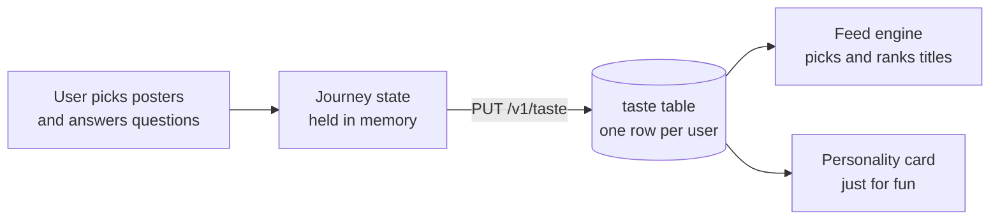
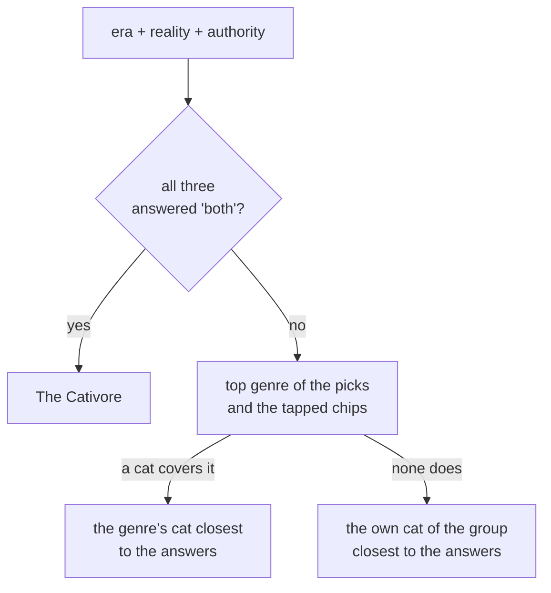

# How the taste journey works

A guide to the taste flow: what each screen does, what gets saved, and how the
feed uses it. Covers both repos — the journey lives in the app, the data and the
scoring live in the backend.

## The short version

The user picks films and shows they like. From those picks the app guesses which
genres they're into, asks four either/or questions, and asks what to avoid. All
of that is saved as one row in the `taste` table. The feed then uses that row to
decide what to show them.



## The six screens

Every screen reads from one shared in-memory object (`tasteOnboardingAtom`).
Nothing is sent to the backend until the last screen.

| # | Route | What the user does | Rule |
|---|---|---|---|
| 1 | `/taste` (movies) | Taps film posters | Must pick **at least 4** to continue |
| 2 | `/taste/series` | Taps show posters | Optional — "Skip, I mostly watch movies" |
| 3 | `/taste/genres` | Adds genre chips | Genres from their picks are **on and locked** — see below |
| 4 | `/taste/questions/1..4` | Four either/or questions | Each has a third "no preference" option |
| 5 | `/taste/preferences` | Taps things to avoid, sets an "how adventurous" slider | Both optional |
| 6 | `/taste/result` | Nothing — waits | Saves to the backend, shows the personality card |

Screen 1 also loads any previously saved taste, so a returning user sees their
old answers instead of a blank form.

The poster lists and the genre chips are not hardcoded in the app. They come
from one call to `GET /v1/taste/journey` made on screen 1, which returns the
poster pools, the chips, the four questions, the avoid chips and the slider
labels.

## What gets saved

One row in the `taste` table, one row per user. This is everything the product
knows about a user's taste:

| Column | Example | What it's for |
|---|---|---|
| `movieIds` | `[157336, 129, 155, 313369]` | Feeds the "more like this" source, and names the personality |
| `seriesIds` | `[1396]` | Same |
| `seriesSkipped` | `false` | Remembers the skip so the journey can be re-opened |
| `genreIds` | `[18, 878, 16]` | **The main feed signal** |
| `era` | `classic` / `new-release` / `both` | Boosts older or newer titles |
| `reality` | `realistic` / `fantasy` / `both` | Boosts grounded or escapist genres |
| `authority` | `popular` / `critics-choice` / `both` | Boosts crowd-pleasers or high-rated |
| `commitment` | `short` / `long` / `both` | Sets a film length window |
| `avoid` | `["horror", "long-watches"]` | Hard block — those titles never show. Stores stable ids, not the labels shown on screen |
| `exploreLevel` | `0`–`4` | How far the feed may stray from the taste |

Saving also wipes the user's cached feed, so the change shows up right away.

**The confirmed genres are the most important field.** They are used twice: to
ask TMDB for candidate titles in the first place, and to score how well each
candidate matches. If the genres are wrong, the whole feed is wrong. The four
answers and the slider only re-order what the genres already brought in.

The personality card ("you're a ...") is decoration. It's worked out fresh on
every save and never stored, and the feed never reads it. See
[The cat card](#the-cat-card) below.

### What the picked titles do

Until 2026-07-24 the picked films were used only to guess genres and to name the
personality — the titles themselves were thrown away. Someone who picked
Interstellar and Dune was treated exactly like anyone else who likes sci-fi.

They now also go to the feed as title ids, where `CandidateGenerator` asks TMDB
"what's similar to this?" for the user's 5 most-liked titles. Saves and ratings
outrank journey picks, so the picks mainly help new users, whose library is
empty. Full details in `src/feed/how-the-feed-works.md` in the backend.

One thing to expect: those picked films no longer show up in the user's own
feed, because the same list is used to hide titles they already know.

## Screen 3: the genre chips

Each picked title locks **one** genre — its main genre. They can add any other
genre they like, but they can't turn off the ones their own picks produced —
unticking "Drama" right after picking three dramas never made sense.

The list is worked out on the phone, in
`features/taste/steps/genres/screen.tsx`. It's just a set: collect the
`mainGenreId` of every picked title, remove duplicates, done. So four picks can
lock at most four of the eighteen genres, and picking both titles of a genre
locks one.

The poster pools are built for this: two titles per genre, and every title's
main genre is one TMDB really gives it. The list runs one title per genre before
it repeats, broadest genre first, so the twelve posters on the first page cover
twelve different genres. `src/taste/constants/pools.spec.ts` in the backend holds
those rules.

The chips show only the emoji and the genre name. They used to carry example
titles ("La La Land" under Music), which collided with the user's own picks — a
chip could name a film they had just picked while sitting unticked.

Locked genres follow the picks both ways. Going back to change titles and
returning to this step adds the genres of the new picks and **drops the genres
of the ones let go** — a genre nothing points at any more shouldn't stay ticked.
Anything the user tapped themselves is kept apart (`addedGenreIds` in the
journey state, never saved) and survives either way, so a title and a tap on the
same genre don't cancel each other out.

### Why one genre per pick

Three earlier rules all had problems:

| Rule | Problem |
|---|---|
| `count × rarity ≥ 1.6` (the original bug) | One pick of a rare genre beat three picks of a common one. Picking Interstellar, Spirited Away, Dark Knight and La La Land ticked **only Music**. |
| Count first, rarity for ties, top 5 | Fairer, but the cap was arbitrary — 10 varied picks still gave 5 genres, and the cut was invisible to the user. |
| Every genre of every pick | A title carries three genres it didn't choose, so the minimum four picks locked about half the list. Almost nothing was left to answer. |

The app still doesn't judge, it just asks for less: one genre per poster, chosen
when the pool is written rather than worked out at runtime. The feed's own
scoring decides how much each genre counts. Rarity weights still exist on the
backend, but only the personality card uses them (`topGenre` in
`personality.ts`), and that one counts the same main genres plus the saved
genre list.

## The cat card

Screen 6 shows one picture and three buttons. The picture is a finished card
that already has everything drawn into it — the tagline, the cat's name, the
description, "Only 16% of watchers", and the Meowie mark. The app draws no text
over it.

The pictures live in S3, one PNG per cat, 2160 x 3856:

```
https://meowie-public.s3.eu-central-1.amazonaws.com/taste/personalities/<name>.png
```

There are 25 cats. The genre leads and the answers follow:



**Step 1 — the top genre.** Every pick votes once, for its main genre — the one
the user saw locked on the genre screen — and every genre in the saved list
votes once more. The genre with the most votes wins; ties go to the rarer genre,
so a common one can't win by being everywhere.

**Step 2 — the cat.** Sixteen cats each stand for a genre inside one of 8 groups
(a group is one side of each of the three questions: era, reality and taste —
commitment plays no part, it only steers the feed). If any cat covers the top
genre, the one whose group agrees most with the user's answers wins. So the
picks decide *which character* and the answers decide *which version* of it —
Fantasy alone can land on Edward Scissorpaws, Hairy Pawter or Furrodo Bagpaws
depending on the answers.

If no cat covers the top genre (Comedy and Romance have none, for example), the
own cat of the group that agrees most with the answers steps in.

A "no preference" answer simply matches neither side and lets the other answers
decide; the last tie always breaks toward the popular-modern side. The card used
to guess a "no preference" from the picks instead (older picks meant classic, a
`hiddenGem` pool flag meant critics' choice) — three extra rules to maintain for
a picture, so it's gone.

| Group | Its own cat | Its two genre cats |
|---|---|---|
| classic · realistic · popular | Rocky Pawboa | Drama → Furrest Gump, Crime → Tony Meowtana |
| classic · realistic · critics | The Catfather | Thriller → Hannibal Licker, History → Maximeow |
| classic · fantasy · popular | Luke Skywhisker | Adventure → Indiana Bones, Animation → Simeow |
| classic · fantasy · critics | Ripurr | Horror → Jack Scratchrance, Fantasy → Edward Scissorpaws |
| new · realistic · popular | Wolf of Wool Street | Action → John Whisk, Music → Freddie Purrcury |
| new · realistic · critics | Heisenpurr | Drama → Tony Sopurrano, Mystery → Rust Clawle |
| new · fantasy · popular | The Dark Kitten | Sci-fi → Iron Cat, Fantasy → Hairy Pawter |
| new · fantasy · critics | Paw Atreides | Fantasy → Furrodo Bagpaws, Thriller → Dream Whisker |

The backend sends back only two things: the picture's address and the cat's
name. The name is used in the share message and nowhere else — everything else
a user reads is inside the picture.

The two buttons: **Share my type** opens the normal share sheet with the
picture attached, and **Start exploring** goes to the feed.
