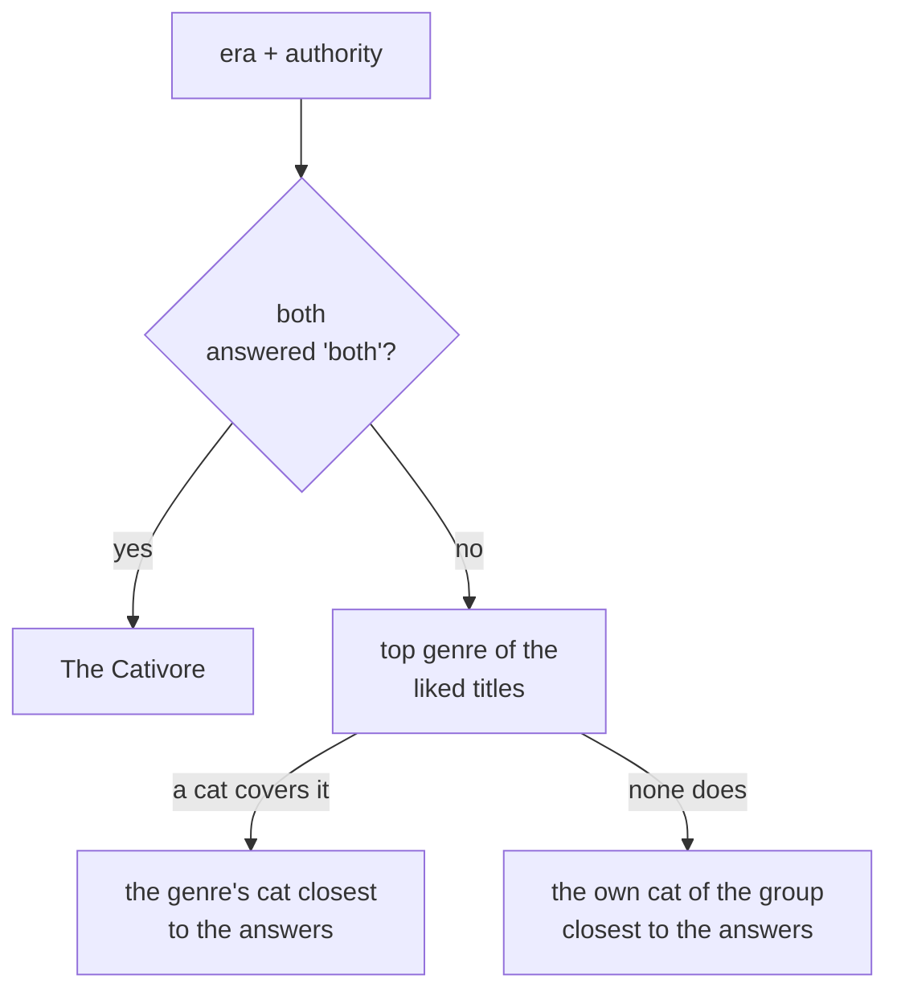

# How the taste journey works

A guide to the taste flow: what each screen does, what gets saved, and how the
feed uses it. Covers both repos — the journey lives in the app, the data and the
scoring live in the backend.

## The short version

The user goes through a deck of posters and says, for each one, whether they
like it, don't like it, or haven't seen it. Then they answer two either/or
questions and say what to avoid. All of that is saved as one row in the `taste`
table. The feed then uses that row to decide what to show them.


## The five screens

Every screen reads from one shared in-memory object (`tasteJourneyAtom`).
Nothing is sent to the backend until the last screen.

| # | Route | What the user does | Rule |
|---|---|---|---|
| 1 | `/taste` (movies) | Rates film posters | Must rate **at least 5** to continue — 👍 and 👎 count, 🙈 doesn't |
| 2 | `/taste/series` | Rates show posters | Optional — Next is always on |
| 3 | `/taste/questions/1..2` | Two either/or questions | Each has a third "no preference" option |
| 4 | `/taste/preferences` | Taps things to avoid, sets an "how adventurous" slider | Both optional |
| 5 | `/taste/result` | Nothing — waits | Saves to the backend, shows the personality card |

Screen 1 also loads any previously saved taste, so a returning user sees their
old answers instead of a blank deck.

The poster decks are not hardcoded in the app. They come from one call to
`GET /v1/taste/journey` made on screen 1, which returns the two pools, the two
questions, the avoid chips and the slider labels.

## The poster deck

One poster fills most of the screen. Flick up for the next title, down for the
one before. Under it sit three buttons: 👎 don't like, 🙈 haven't seen, 👍 like.
Tapping one saves the answer and slides the next poster in on its own. Coming
back to a title shows its answer again, and tapping a different button changes
it.

The flat grey card peeking out below the poster is decoration. It says "there
are more below" and is never the next title — that is why it carries no artwork.

The deck holds the whole pool: 36 films and 26 series. They are ordered one
genre at a time, so the first posters cover as many kinds of title as possible.

Files: `elements/poster-deck.tsx` (the deck), `elements/rating-buttons.tsx` (the
three buttons), `elements/rating-step.tsx` (the two together), and the two
screens under `steps/movies` and `steps/series`.

## What gets saved

One row in the `taste` table, one row per user. This is everything the product
knows about a user's taste:

| Column | Example | What it's for |
|---|---|---|
| `movieRatings` | `{ "157336": "like", "389": "dislike" }` | **The main feed signal** — see below |
| `seriesRatings` | `{ "1396": "not-seen" }` | Same, for series |
| `era` | `classic` / `new-release` / `both` | Boosts older or newer titles |
| `authority` | `popular` / `critics-choice` / `both` | Boosts crowd-pleasers or high-rated |
| `avoid` | `["horror", "documentaries"]` | Hard block — those titles never show. Stores stable ids, not the labels shown on screen |
| `exploreLevel` | `0`–`4` | How far the feed may stray from the taste |

Saving also wipes the user's cached feed, so the change shows up right away.

**The liked titles are the most important field.** The feed's biggest source is
"what TMDB recommends off the titles you liked". Disliked titles do two things:
they never show up in the feed, and anything TMDB recommends off them is pushed
down the ranking. "Haven't seen it" does neither — it is remembered so the deck
can show the answer again, and nothing else reads it.

The two answers and the slider only re-order what the liked titles and the
popular source already brought in. Full details in
`src/feed/how-the-feed-works.md` in the backend.

The personality card ("you're a ...") is decoration. It's worked out fresh on
every save and never stored, and the feed never reads it. See
[The cat card](#the-cat-card) below.

## Genres

There aren't any. Until August 2026 there was a third screen where the user
confirmed a list of genres, and that list was the feed's main aim — TMDB
discover was asked for `genres=18,878,…`. It is gone: no genre step, no stored
genre list, and nothing works one out from the picks for the feed.

What replaced it is the deck itself. A rated title is a much more exact thing to
say than "I like drama", and TMDB's own "people who liked this also liked…" does
the widening that the genre sweep used to do.

The one place a genre still appears is inside the cat card, below, which counts
the main genre of the titles the user liked. That never leaves the server and
never reaches the feed.

## The cat card

Screen 5 shows one picture and three buttons. The picture is a finished card
that already has everything drawn into it — the tagline, the cat's name, the
description, "Only 16% of watchers", and the Meowie mark. The app draws no text
over it.

The pictures live in S3, one PNG per cat, 2160 x 3856:

```
https://meowie-public.s3.eu-central-1.amazonaws.com/taste/personalities/<name>.png
```

There are 21 cats in use. The liked titles lead and the answers follow:



**Step 1 — the top genre.** Every liked title votes once, for its main genre.
The genre with the most votes wins; ties go to the rarer genre, so a common one
can't win by being everywhere. Dislikes and "haven't seen it" don't vote, so a
user who liked nothing skips straight to their group's own cat.

**Step 2 — the cat.** Sixteen cats each stand for a genre inside one of 4 groups
(a group is one side of each question: era and taste). If any cat covers the top
genre, the one whose group agrees most with the user's answers wins. So the
liked titles decide *which character* and the answers decide *which version* of
it — Fantasy alone can land on Edward Scissorpaws, Hairy Pawter or Furrodo
Bagpaws depending on the answers.

If no cat covers the top genre (Comedy and Romance have none, for example), the
own cat of the group that agrees most with the answers steps in.

A "no preference" answer simply matches neither side and lets the other answers
decide; the last tie always breaks toward the popular-modern side.

| Group | Its own cat | Its four genre cats |
|---|---|---|
| classic · popular | Luke Skywhisker | Drama → Furrest Gump, Crime → Tony Meowtana, Adventure → Indiana Bones, Animation → Simeow |
| classic · critics | The Catfather | Thriller → Hannibal Licker, History → Maximeow, Horror → Jack Scratchrance, Fantasy → Edward Scissorpaws |
| new · popular | The Dark Kitten | Action → John Whisk, Music → Freddie Purrcury, Sci-fi → Iron Cat, Fantasy → Hairy Pawter |
| new · critics | Heisenpurr | Drama → Tony Sopurrano, Mystery → Rust Clawle, Fantasy → Furrodo Bagpaws, Thriller → Dream Whisker |

Four cats lost their group when the reality question went and are no longer
picked: Rocky Pawboa, Ripurr, Wolf of Wool Street and Paw Atreides. Their
pictures are still in S3, so any of them can take over a group's own cat.

The backend sends back only two things: the picture's address and the cat's
name. The name is used in the share message and nowhere else — everything else
a user reads is inside the picture.

The two buttons: **Share my type** opens the normal share sheet with the
picture attached, and **Start exploring** goes to the feed.
