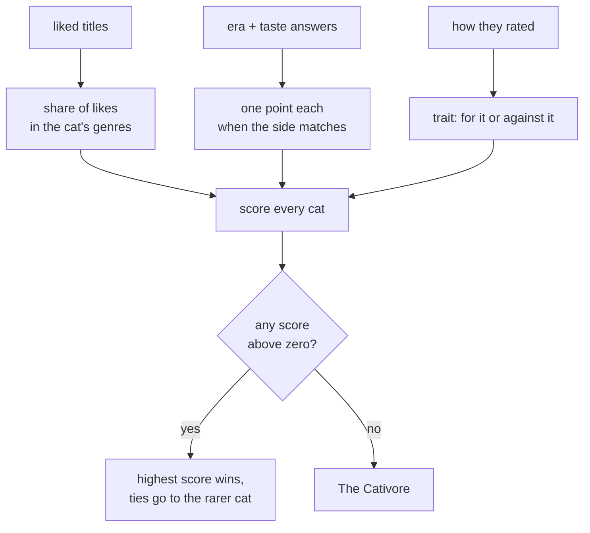

# How the taste journey works

A guide to the taste flow: what each screen does, what gets saved, and how the
feed uses it. Covers both repos — the journey lives in the app, the data and the
scoring live in the backend.

## The short version

The user goes through a deck of posters and says, for each one, whether they
like it, don't like it, or haven't seen it. Then they answer two either/or
questions and say what to avoid. All of that is saved as one row in the `taste`
table. The feed then uses that row to decide what to show them.


## The five screens

Every screen reads from one shared in-memory object (`tasteJourneyAtom`).
Nothing is sent to the backend until the last screen.

| # | Route | What the user does | Rule |
|---|---|---|---|
| 1 | `/taste` (movies) | Rates film posters | Must rate **at least 5** to continue — 👍 and 👎 count, 🙈 doesn't |
| 2 | `/taste/series` | Rates show posters | Optional — Next is always on |
| 3 | `/taste/questions/1..2` | Two either/or questions | Each has a third "no preference" option |
| 4 | `/taste/preferences` | Taps things to avoid, sets an "how adventurous" slider | Both optional |
| 5 | `/taste/result` | Nothing — waits | Saves to the backend, shows the personality card |

Screen 1 also loads any previously saved taste, so a returning user sees their
old answers instead of a blank deck.

The poster decks are not hardcoded in the app. They come from one call to
`GET /v1/taste/journey` made on screen 1, which returns the two pools, the two
questions, the avoid chips and the slider labels.

## The poster deck

One poster fills most of the screen. Flick up for the next title, down for the
one before. Under it sit three buttons: 👎 don't like, 🙈 haven't seen, 👍 like.
Tapping one saves the answer and slides the next poster in on its own. Coming
back to a title shows its answer again, and tapping a different button changes
it.

The flat grey card peeking out below the poster is decoration. It says "there
are more below" and is never the next title — that is why it carries no artwork.

The deck holds the whole pool: 117 films and 69 series across 18 genres. They
are dealt one genre at a time, so the first posters cover every genre before any
genre comes round again.

The titles are chosen to divide people, not because they are the best films ever
made. A title everyone likes says nothing about the person rating it, so the
deck leans on the ones that start arguments.

Files: `elements/poster-deck.tsx` (the deck), `elements/rating-buttons.tsx` (the
three buttons), `elements/rating-step.tsx` (the two together), and the two
screens under `steps/movies` and `steps/series`.

## What gets saved

One row in the `taste` table, one row per user. This is everything the product
knows about a user's taste:

| Column | Example | What it's for |
|---|---|---|
| `movieRatings` | `{ "157336": "like", "389": "dislike" }` | **The main feed signal** — see below |
| `seriesRatings` | `{ "1396": "not-seen" }` | Same, for series |
| `era` | `classic` / `new-release` / `both` | Boosts older or newer titles |
| `authority` | `popular` / `critics-choice` / `both` | Boosts crowd-pleasers or high-rated |
| `avoid` | `["horror", "documentaries"]` | Hard block — those titles never show. Stores stable ids, not the labels shown on screen |
| `exploreLevel` | `0`–`4` | How far the feed may stray from the taste |

Saving also wipes the user's cached feed, so the change shows up right away.

**The liked titles are the most important field.** The feed's biggest source is
"what TMDB recommends off the titles you liked". Disliked titles do two things:
they never show up in the feed, and anything TMDB recommends off them is pushed
down the ranking. "Haven't seen it" does neither — it is remembered so the deck
can show the answer again, and nothing else reads it.

The two answers and the slider only re-order what the liked titles and the
popular source already brought in. Full details in
`src/feed/how-the-feed-works.md` in the backend.

The personality card ("you're a ...") is decoration. It's worked out fresh on
every save and never stored, and the feed never reads it. See
[The cat card](#the-cat-card) below.

## Genres

There aren't any. Until August 2026 there was a third screen where the user
confirmed a list of genres, and that list was the feed's main aim — TMDB
discover was asked for `genres=18,878,…`. It is gone: no genre step, no stored
genre list, and nothing works one out from the picks for the feed.

What replaced it is the deck itself. A rated title is a much more exact thing to
say than "I like drama", and TMDB's own "people who liked this also liked…" does
the widening that the genre sweep used to do.

The one place a genre still appears is inside the cat card, below, which reads
the main genre of the titles the user liked. Each deck title carries exactly one
hand-set `mainGenreId`; it never leaves the server and never reaches the feed.

## The cat card

Screen 5 shows one picture and three buttons. The picture is a finished card
that already has everything drawn into it — the tagline, the cat's name, the
description, "Only 16% of watchers", and the Meowie mark. The app draws no text
over it.

The pictures live in S3, one PNG per cat, 2160 x 3856:

```
https://meowie-public.s3.eu-central-1.amazonaws.com/taste/personalities/<name>.png
```

There are 24 cats plus The Cativore. Every cat is a row with four leanings, and
the one that fits the user best wins — there are no groups and no fallback
chain:

| Field | What it means |
|---|---|
| `genres` | The genres this cat stands for. Counts for the most. |
| `era` | `classic` or `new-release`, matched against the era answer |
| `authority` | `popular` or `critics-choice`, matched against the taste answer |
| `trait` | How the person rated, not what they rated. Optional. |
| `rarity` | Breaks ties only. The rarer cat wins, because it's more fun to get. |



**The genres carry the most weight (×3).** Not a single winning vote — the
*share* of the user's likes sitting in that cat's genres, weighted so a rare
genre counts for more than a common one. Two westerns beat two dramas.

**The two answers add a point each.** They can only choose between cats the
genres already brought close, which is why crime plus "classics, critics" lands
on The Catfather while crime plus "new, popular" lands on Wolf of Wool Street.

**The trait uses what nothing else does.** Likes, dislikes and skips describe a
person on their own: mostly dislikes is `hard-to-please`, mostly likes is
`easy-going`, a deck of skips is `lots-left-to-watch`. A matching cat gains 1.5,
a cat that stands for the opposite way of rating loses 1.5 — otherwise the trait
would only ever settle ties.

A "no preference" answer matches no side and simply adds nothing. Someone who
liked nothing and took no side scores zero everywhere and gets The Cativore.

Four genres in the deck have no cat yet: Romance, Documentary, War and Western.
Nothing breaks — those users land on the cat that fits their answers and their
trait instead — but they're the obvious next cats to draw.

The backend sends back only two things: the picture's address and the cat's
name. The name is used in the share message and nowhere else — everything else
a user reads is inside the picture.

The two buttons: **Share my type** opens the normal share sheet with the
picture attached, and **Go home** leaves the journey for the feed.
